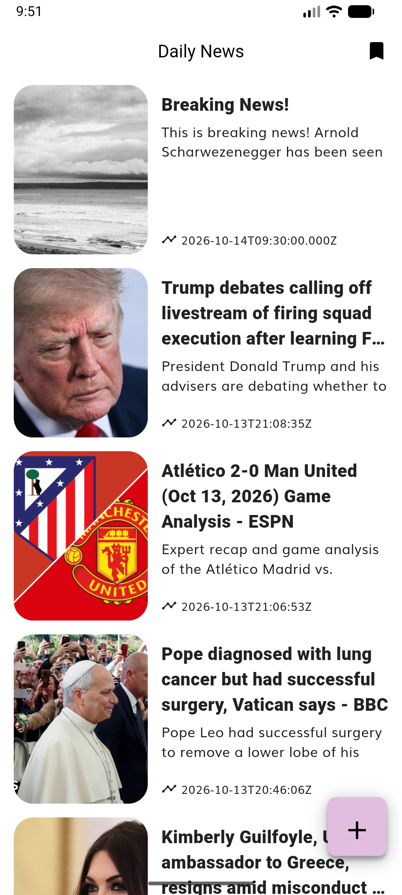
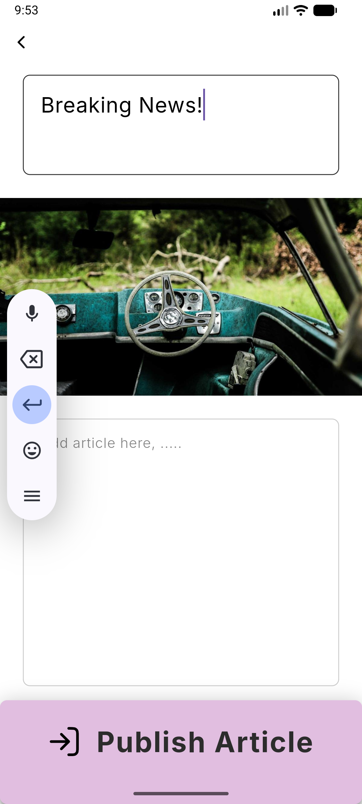
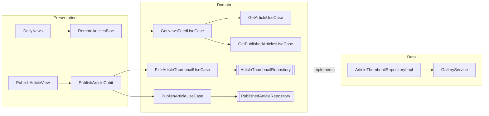

# Report – Applicant Showcase App

> **Draft.** This report is written while the project is being built. Sections marked _(pending)_ are completed at the end.

## Contents
1. [Introduction](#1-introduction)
2. [Learning Journey](#2-learning-journey)
3. [Challenges Faced](#3-challenges-faced)
4. [Reflection and Future Directions](#4-reflection-and-future-directions)
5. [Proof of the Project](#5-proof-of-the-project)
6. [Overdelivery](#6-overdelivery)
7. [Extra Sections](#7-extra-sections)

---

## 1. Introduction

I was really happy when I received this assignment. Programming is what I enjoy most, and this project is especially close to me because I am a real user of the product. I feel that Symmetry and I share very similar values, and I **want** to be part of this project.

I started programming when I was around 16, building very basic things with Unity and Python. Since then I have kept learning step by step: I completed the higher vocational degree in Web Application Development (*Ciclo Formativo de Grado Superior en Desarrollo de Aplicaciones Web*) and the 42 programme at Fundación Telefónica.

Before this project I knew about Flutter, Firebase and Clean Architecture, but I had never used them in a real project, and BLoC was completely new to me.

## 2. Learning Journey

I approached the assignment the way it is meant to be approached: learning the technologies while building, and following the repository documentation as the source of truth.

**How I worked**
- **Documentation first.** Before writing any code, the whole repository documentation (README, architecture, violations, coding and contribution guidelines, report instructions) was audited and turned into a list of mandatory requirements and a phased plan.
- **AI pair programming, with me in charge of the decisions.** I used Claude Code as a pair programmer. Every proposal had to come with an explicit check against the project rules (each rule cited, with ✅ or ❌), and I approved or rejected every decision. When a proposal did not comply 100%, it was flagged and replaced (for example, keeping `equatable` inside the domain layer was rejected because the domain must not import external packages).
- **One phase, one branch, one reviewed pull request**, following the contribution guidelines: compatibility of the starter project → backend schema and rules → domain layer → state management → UI → Firebase connection → data layer → report.
- **Verifying instead of assuming.** Every phase ended with automated tests and a manual run on an Android emulator.

**What I learned**
- **Flutter BLoC / Cubit**, the technology that was new to me: modelling screen states (`editing`, `publishing`, `published`, `invalid`, `failure`), keeping business logic out of blocs, and testing cubits and blocs.
- **Clean Architecture in practice**: what each layer may import, why hardware access (the photo gallery) belongs to a data source, why entities carry business rules (character limits, the derived description) and why the domain must stay pure Dart.
- **Firebase**: designing a NoSQL schema, enforcing it with Firestore and Cloud Storage security rules, testing those rules on the Local Emulator Suite, and deploying them with the Firebase CLI.
- **Turning a design into code with high fidelity**: with view-only access to Figma, I exported the screens as SVG to obtain the exact colours, fonts, sizes, radii, shadows and icons.
- **The Android build toolchain** (Gradle, Android Gradle Plugin, Kotlin, JDK, NDK) and how they depend on each other.
- **Testing at three levels**: unit tests, widget tests and an integration test of the whole publishing journey.

## 3. Challenges Faced

### 3.1 The starter project did not build with current Flutter
With Flutter 3.47 the original project failed to build. I fixed it with the **minimum change required by each actual error**, one error at a time:

| Error | Fix |
|---|---|
| Gradle 8.4 cannot run on the JDK 25 bundled with Android Studio | JDK 21 for Flutter, Gradle 8.14.3 |
| Flutter requires newer Android tooling | Android Gradle Plugin 8.11.1, Kotlin 2.2.20, NDK 27 |
| `win32` and `ionicons` no longer compile with Dart 3 | Updated versions (and renamed three icon usages) |
| `path_provider_android` and `sqflite` use the removed v1 plugin embedding | Updated versions in `pubspec.lock` only |

**Lesson:** read the error, change only what it asks for, and document the toolchain requirements (now in `frontend/README.md`).

### 3.2 A black screen on the emulator
The app was running (the logs showed articles being loaded) but the screen was black. By checking the rendered frames and the renderer, I found that the Impeller renderer does not work with the GPU emulation of recent Android emulator images. Running with `--no-enable-impeller` solved it, with no change to the code.

### 3.3 Cloud Storage requires the Blaze plan
New Firebase projects need the pay-as-you-go Blaze plan to use Cloud Storage, which the assignment requires for the thumbnails. I upgraded the project, created the bucket in a no-cost region (`US-EAST1`) and set a budget alert.

### 3.4 The rules tests found a real security hole
I wrote 30 tests for the Firestore and Storage security rules, running against the Local Emulator Suite. One of them showed that an existing thumbnail **could be overwritten** by anyone. I fixed the rule so that a file can only be created when nothing exists at that path. Writing the tests also showed that the tests themselves must be independent (each one now uses its own file).

### 3.5 Clean Architecture grey areas
The documentation was the source of truth, so every grey area was resolved explicitly:
- **Pure domain.** The starter's domain layer depended on external packages (`equatable`, and `dio` through `DataState`). Both were removed from the domain: entities implement equality in pure Dart and `DataState` stores any `Exception`.
- **"Use mock data inside the usecases"** (README) versus "use cases use repository interfaces" (rule 2.3.2). I followed the README literally during the UI phases and moved the use cases to the repository interface when the data layer was built.
- **The photo gallery is hardware**, and rule 1.2.3 says only data sources may access hardware. Even the image picker therefore goes through a data source, a repository and a use case.

### 3.6 Legacy code generators
`bloc_test` could not be installed because the starter's code generators (`retrofit_generator`, `floor_generator`) depend on an analyzer version that is incompatible with modern test packages. Updating the generators would have been a broad refactor, so I tested blocs and cubits with `flutter_test` and `mocktail` instead.

### 3.7 High fidelity from a view-only Figma file
Without Dev Mode, Figma does not show colours or fonts. Exporting the frames as SVG gave me the exact values, and even the original icon paths, which the app uses directly. Figma shadow blur values had to be converted to Flutter blur radii.

Building the screen also exposed problems that only appear on real devices:
- The text of the loading overlay was drawn with a yellow underline because it had no `Material` ancestor.
- The widget tests showed that the button labels overflowed on narrow screens or with large system fonts. They now scale down instead.

### 3.8 Testing a journey that opens the system photo picker
The system photo picker cannot be automated. In the integration test I replaced only the native picker implementation, so the app's own code (data source, repository, use case, cubit and screen) runs unchanged.

## 4. Reflection and Future Directions
_(pending)_

## 5. Proof of the Project

| Screen | Screenshot |
|---|---|
| Home feed: published articles together with the news API, new "+" button |  |
| Publish article, empty draft (Figma "TODO: Publish Article") |  |
| Validation messages when publishing an empty draft |  |
| Photos-only system gallery |  |
| Draft with title and image (Figma "Publish Article::DataAdded") |  |
| Confirmation after publishing, back on the refreshed feed |  |

**Video:** _(pending)_

## 6. Overdelivery

### 6.1 New features implemented
- **Design annotations from the Figma prototype** (suggestions, not requirements):
  - #1 maximum number of characters (title 100, content 5000), enforced in the app and in the security rules;
  - #2 the button opens the gallery with photos only;
  - #4 tapping the image picks another one;
  - #6 clear messages for whatever is missing;
  - #7 confirmation after publishing;
  - #8 loading overlay while publishing.
- **A resilient combined feed**: published articles and news API articles, newest first. If one source fails, the other one is still shown.
- **Security rules covered by 30 automated tests** on the Local Emulator Suite.
- **Unit, widget and integration tests** for the new functionality, including the full publishing journey on an emulator.
- **Fixes to the starter project** (Boy Scout rule):
  - the home screen loaded forever when the feed was empty;
  - the saved-articles bloc crashed when comparing events or states;
  - the folders did not follow the documented architecture (`use_cases/`, `screens/`).

### 6.2 Prototypes created
_(pending)_

### 6.3 How can you improve this
- **Firebase Authentication**: an `authorId` field, editing and deleting your own articles, ownership-based rules.
- **Firebase App Check** to accept writes only from the app.
- **Rich text** (Markdown) for subheadings and bold text (Figma annotation #3).
- **A scheduled Cloud Function** to delete thumbnails that are never referenced by an article.
- **Updating the starter's code generators**, which would unblock `bloc_test` and newer dependencies.
- **An accessibility review** (screen reader labels, dynamic type) and dark mode.

## 7. Extra Sections

### 7.1 Architecture of the publishing feature

### 7.2 Justified exceptions to the coding guidelines
- **CG3.5 (few arguments).** Entity and state constructors (and the `OutlinedTextArea` widget) take more than three *named* parameters. They are value objects mirroring the schema fields, like the original `ArticleEntity` with eight.
- **Screens obtain their cubit from the service locator (`sl`)**, as the starter's screens already did.

### 7.3 Use of AI
I used Claude Code (Anthropic) as a pair programmer, openly: every commit is co-signed. The AI proposed and wrote code. I set the priorities (for example fidelity to the design over my own preferences), and I reviewed and approved each decision and each pull request, always against the project documentation.
