# Report – Applicant Showcase App

## Contents
1. [Introduction](#1-introduction)
2. [Learning Journey](#2-learning-journey)
3. [Challenges Faced](#3-challenges-faced)
4. [Reflection and Future Directions](#4-reflection-and-future-directions)
5. [Proof of the Project](#5-proof-of-the-project)
6. [Overdelivery](#6-overdelivery)
7. [Extra Sections](#7-extra-sections)

---

## 1. Introduction

I was really happy when I received this assignment. Programming is what I enjoy most, and this project is especially close to me because I am a real user of the product. I feel that Symmetry and I share very similar values, and I **want** to be part of this project.

I started programming when I was around 16, building very basic things with Unity and Python. Since then I have kept learning step by step: I completed the higher vocational degree in Web Application Development (*Ciclo Formativo de Grado Superior en Desarrollo de Aplicaciones Web*) and the 42 programme at Fundación Telefónica.

Before this project I knew about Flutter, Firebase and Clean Architecture, but I had never used them in a real project, and BLoC was completely new to me.

**What was built:** journalists can now publish their own articles from the app (title, thumbnail and full story). The articles are stored in Firebase (Firestore and Cloud Storage) and appear in the home feed for everyone, together with the news API articles.

## 2. Learning Journey

I approached the assignment the way it is meant to be approached: learning the technologies while building, and following the repository documentation as the source of truth.

**How I worked**
- **Documentation first.** Before writing any code, the whole repository documentation (README, architecture, violations, coding and contribution guidelines, report instructions) was audited and turned into a list of mandatory requirements and a phased plan.
- **AI pair programming, with me in charge of the decisions.** I used Claude Code as a pair programmer. Every proposal had to come with an explicit check against the project rules (each rule cited, with ✅ or ❌), and I approved or rejected every decision. When a proposal did not comply 100%, it was flagged and replaced (for example, keeping `equatable` inside the domain layer was rejected because the domain must not import external packages).
- **One phase, one branch, one reviewed pull request**, following the contribution guidelines (see [7.1](#71-development-history)).
- **Verifying instead of assuming.** Every phase ended with automated tests, an audit of the guidelines and a manual run on an Android emulator. The final phases were tested against the real Firebase project.

**What I learned**
- **Flutter BLoC / Cubit**, the technology that was new to me: modelling screen states (`editing`, `publishing`, `published`, `invalid`, `failure`), keeping business logic out of blocs, and testing cubits and blocs.
- **Clean Architecture in practice**: what each layer may import, why hardware access (the photo gallery) belongs to a data source, why entities carry business rules (character limits, the derived description, the article body) and why the domain must stay pure Dart.
- **Firebase**: designing a NoSQL schema, enforcing it with Firestore and Cloud Storage security rules, testing those rules on the Local Emulator Suite, deploying them, connecting a Flutter app with the FlutterFire CLI, and protecting the project (restricted API key, budget alert).
- **Turning a design into code with high fidelity**: with view-only access to Figma, I exported the screens as SVG to obtain the exact colours, fonts, sizes, radii, shadows and icons.
- **The Android build toolchain** (Gradle, Android Gradle Plugin, Kotlin, JDK, NDK) and how they depend on each other.
- **Testing at four levels**: unit tests, widget tests, security rules tests and an integration test of the whole publishing journey running on the Firebase emulators.

## 3. Challenges Faced

### 3.1 The starter project did not build with current Flutter
With Flutter 3.47 the original project failed to build. I fixed it with the **minimum change required by each actual error**, one error at a time:

| Error | Fix |
|---|---|
| Gradle 8.4 cannot run on the JDK 25 bundled with Android Studio | JDK 21 for Flutter, Gradle 8.14.3 |
| Flutter requires newer Android tooling | Android Gradle Plugin 8.11.1, Kotlin 2.2.20, NDK 27 |
| `win32` and `ionicons` no longer compile with Dart 3 | Updated versions (and renamed three icon usages) |
| `path_provider_android` and `sqflite` use the removed v1 plugin embedding | Updated versions in `pubspec.lock` only |

**Lesson:** read the error, change only what it asks for, and document the toolchain requirements (now in `frontend/README.md`).

### 3.2 A black screen on the emulator
The app was running (the logs showed articles being loaded) but the screen was black. By checking the rendered frames and the renderer, I found that the Impeller renderer does not work with the GPU emulation of recent Android emulator images. Running with `--no-enable-impeller` solved it, with no change to the code.

### 3.3 Cloud Storage requires the Blaze plan
New Firebase projects need the pay-as-you-go Blaze plan to use Cloud Storage, which the assignment requires for the thumbnails. I upgraded the project, created the bucket in a no-cost region (`US-EAST1`) and set a budget alert.

### 3.4 The rules tests found a real security hole
I wrote 30 tests for the Firestore and Storage security rules, running against the Local Emulator Suite. One of them showed that an existing thumbnail **could be overwritten** by anyone. I fixed the rule so that a file can only be created when nothing exists at that path. Writing the tests also showed that the tests themselves must be independent (each one now uses its own file).

### 3.5 Clean Architecture grey areas
The documentation was the source of truth, so every grey area was resolved explicitly:
- **Pure domain.** The starter's domain layer depended on external packages (`equatable`, and `dio` through `DataState`). Both were removed from the domain: entities implement equality in pure Dart and `DataState` stores any `Exception`.
- **"Use mock data inside the usecases"** (README) versus "use cases use repository interfaces" (rule 2.3.2). I followed the README literally during the UI phases and moved the use cases to the repository interface when the data layer was built.
- **The photo gallery is hardware**, and rule 1.2.3 says only data sources may access hardware. Even the image picker therefore goes through a data source, a repository and a use case.

### 3.6 Legacy code generators
The starter's code generators (`retrofit_generator` 3, `floor_generator` 1.2) do not run with Dart 3 and their old analyzer blocked any modern test or generator package (for example `bloc_test`). This mattered twice:
- At first I tested blocs and cubits with `flutter_test` and `mocktail` instead of `bloc_test`.
- Later, `ArticleModel` was also the local database table (`@Entity`), so a model imported the database package, against rule 1.2.4. To fix it I removed `retrofit_generator` (its generated client stays as committed), upgraded `floor_generator` to 1.5, limited code generation to the local database with a `build.yaml`, and moved the table to a `SavedArticleRecord` inside the local data source. The table is unchanged, so saved articles are kept, and new tests run the regenerated database code on an in-memory SQLite database.

### 3.7 High fidelity from a view-only Figma file
Without Dev Mode, Figma does not show colours or fonts. Exporting the frames as SVG gave me the exact values, and even the original icon paths, which the app uses directly. Figma shadow blur values had to be converted to Flutter blur radii.

Building the screen also exposed problems that only appear on real devices:
- The text of the loading overlay was drawn with a yellow underline because it had no `Material` ancestor.
- The widget tests showed that the button labels overflowed on narrow screens or with large system fonts. They now scale down instead.

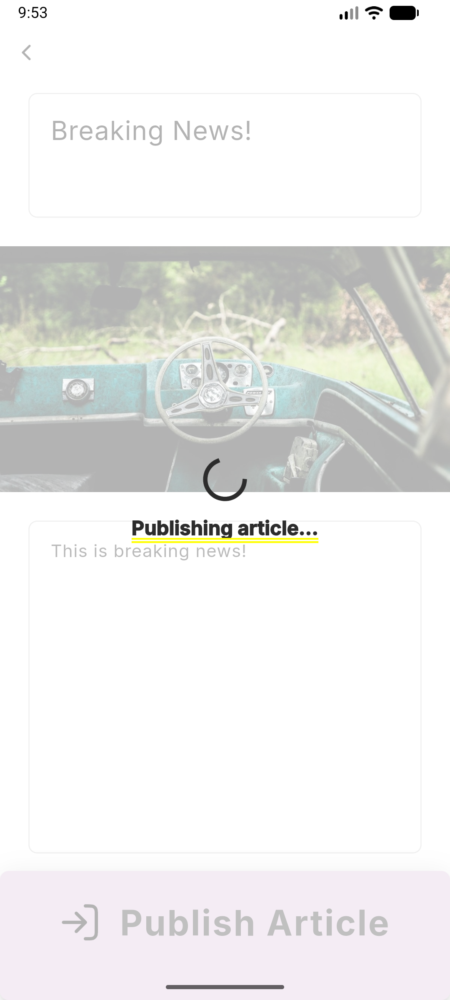

### 3.8 Testing a journey that opens the system photo picker
The system photo picker cannot be automated. In the integration test I replaced only the native picker implementation, so the app's own code (data source, repository, use case, cubit and screen) runs unchanged. The test runs on the Firebase Local Emulator Suite, so it exercises the real security rules without writing test data to the production project.

### 3.9 Bugs found by testing against the real Firebase project
Publishing real articles from the emulator showed a bug that no unit test had covered: the detail screen showed the description and then the content, and for published articles the description is the beginning of the content, so **the text appeared twice**. The article entity now builds the body without repeating the description.

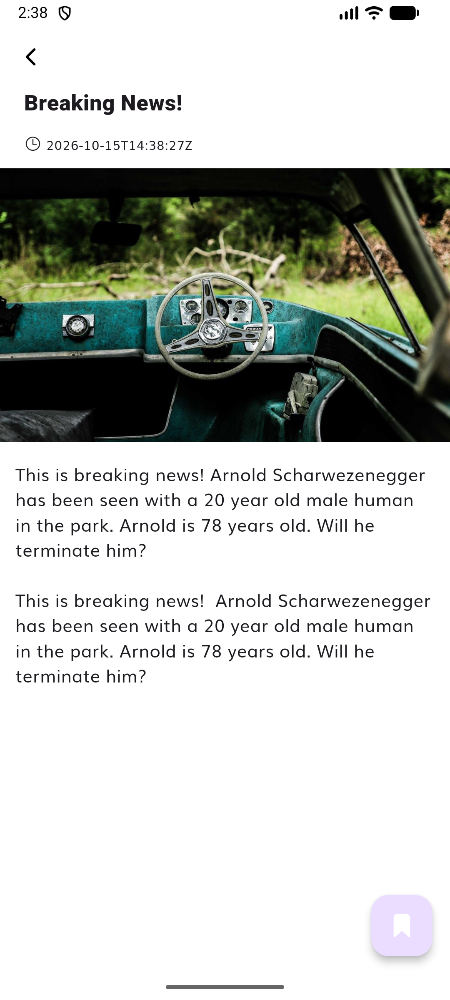

Reviewing the feed also showed that **11 of the 19 news API articles have no image**. The starter replaced it with `kDefaultImage`, which was a Google search URL and not an image, so the feed showed an error icon (and the detail screen could crash). These articles now show a placeholder in the style of the thumbnails.

### 3.10 A secret that cannot be hidden inside a mobile app
The news API key is written in the starter's code (`core/constants/constants.dart`). Moving it to a `.env` file or to `--dart-define` would only remove it from the repository: anything shipped inside the APK can be extracted, and this key is already public in the original repository. The real solution is a server-side proxy (see [7.4](#74-security)). I documented the risk instead of applying a change that only *looks* secure.

## 4. Reflection and Future Directions

This project confirmed what I enjoy about programming: understanding a system, respecting the rules of the team that owns it, and leaving it better than I found it. The most valuable lesson was to treat the documentation as the source of truth and to check every decision against it. Several of the best improvements came from doing exactly that, for example the pure domain layer, keeping providers inside data sources, and the verb-named functions.

On the technical side, I learned BLoC from scratch and Flutter and Firebase in a real project, but above all I learned that **tests and real usage find real bugs**. The rules tests found a security hole, the widget tests found overflowing labels, and running against the real Firebase project found the duplicated text. Each of them would have reached users otherwise.

On the professional side, I learned to work in small, reviewed steps (one branch and one pull request per phase), to communicate trade-offs honestly (for example, documenting the API key risk instead of hiding it) and to use AI as a tool under my own judgement, not as a replacement for it.

**If I continued the project**, I would:
- add Firebase Authentication, so that journalists can edit and delete their own articles;
- add a server-side proxy for the news API and Firebase App Check;
- paginate the feed;
- run an accessibility review.

## 5. Proof of the Project

### Video
[▶ Demo video (1 min 40 s)](report_images/publish_article_demo.mp4), recorded on an Android emulator against the real Firebase project. In order, it shows:
1. the feed;
2. an attempt to publish an empty draft, with its validation messages;
3. the photos-only gallery;
4. writing the article;
5. publishing, with the loading overlay and the confirmation;
6. the new article on top of the feed;
7. its detail.

### Screenshots

| Screen | Screenshot |
|---|---|
| Publish article, empty draft (Figma "TODO: Publish Article") | 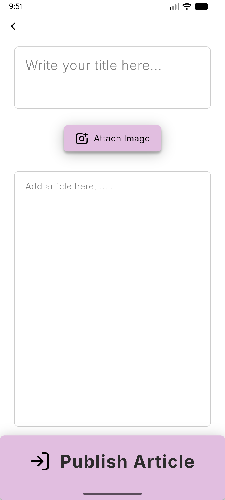 |
| Validation messages when publishing an empty draft | 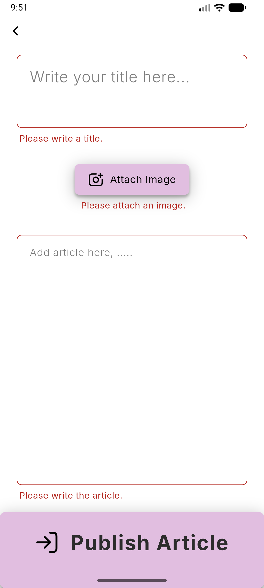 |
| Photos-only system gallery | 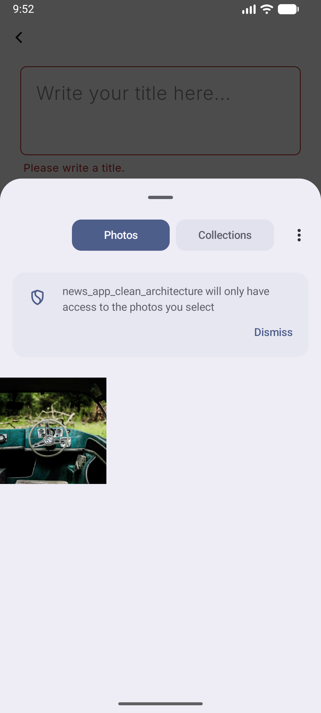 |
| Draft with title, image and content (Figma "Publish Article::DataAdded") | 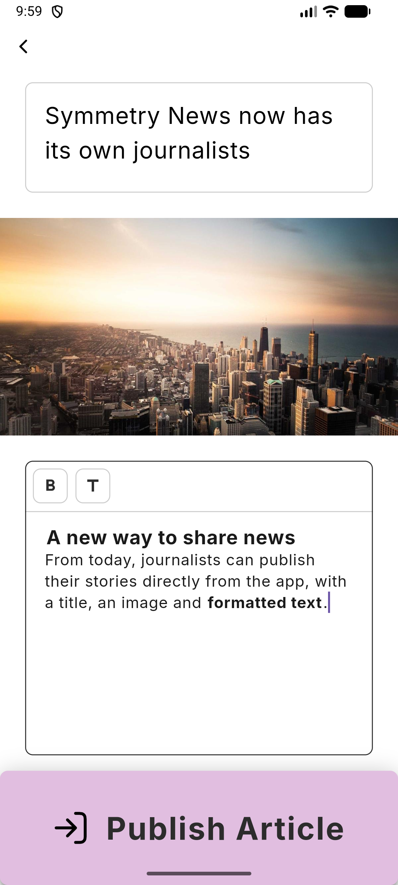 |
| Confirmation after publishing, back on the refreshed feed | 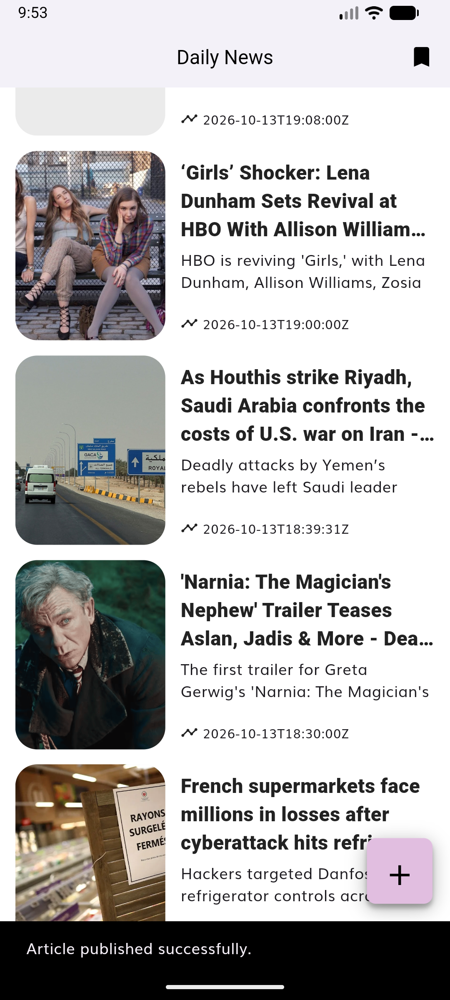 |
| Published articles on top of the feed, read from Firestore and Cloud Storage | 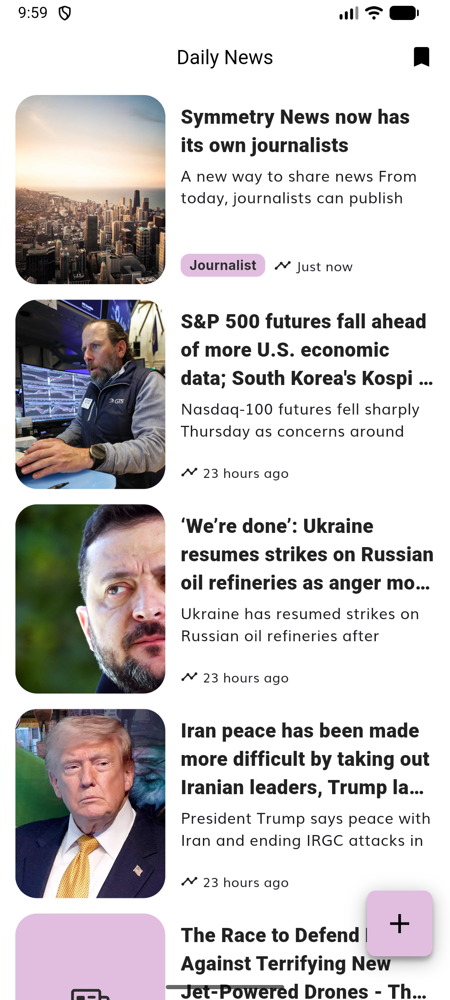 |
| Detail of a published article | 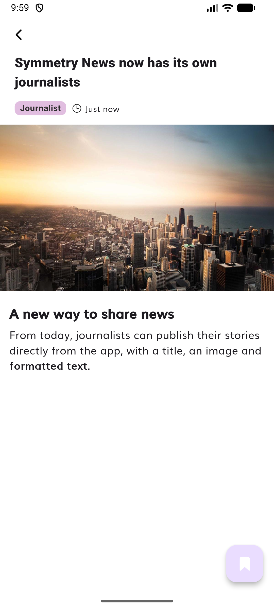 |
| Lilac placeholder for news without image | 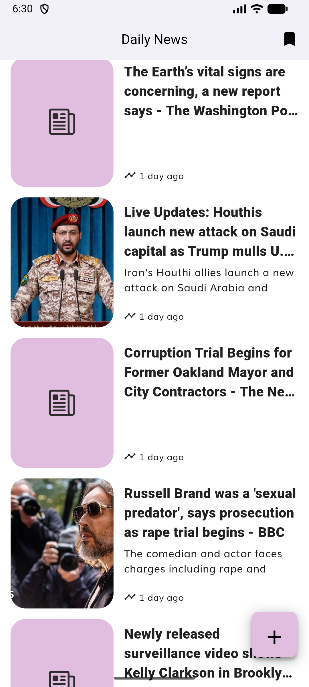 |
| Formatted text while writing, with the bold button highlighted (Figma annotation #3) | 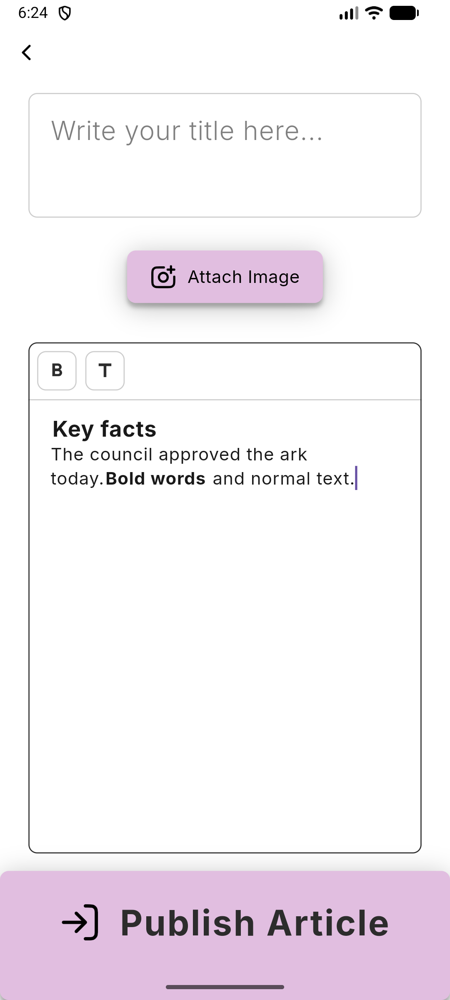 |
| "Journalist" badge and relative dates in the feed (Figma annotation #5) | 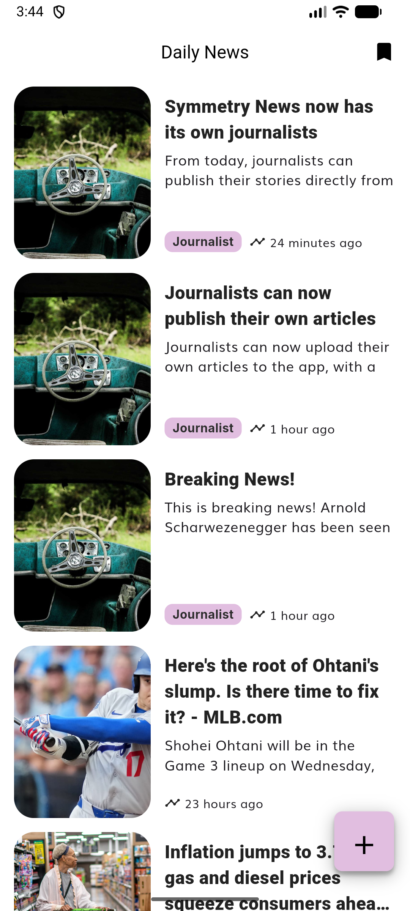 |

## 6. Overdelivery

### 6.1 New features implemented
The repository documentation defines what was required: publishing an article with a title, a thumbnail and content, stored in Firestore and Cloud Storage and following the architecture and coding guidelines. The Figma prototype also contains eight numbered annotations with ideas to improve the feature. They are not part of the documented requirements, so I did not treat them as mandatory. I treated them as improvements proposed by the design itself and implemented them as extra work on top of the required feature.

- **Design annotations from the Figma prototype** (optional improvements, done as extra work):
  - #1 maximum number of characters (title 100, content 5000), enforced in the app and in the security rules;
  - #2 the button opens the gallery with photos only;
  - #3 rich text: a toolbar inside the content field adds **bold** text and subheadings, which are shown formatted while writing and highlight their button. The content is stored as Markdown, rendered with its format in the detail and shown as plain text in the feed;
  - #4 tapping the image picks another one;
  - #5 a better feed: dates like "2 hours ago", a "Journalist" badge on the articles written in the app, pull to refresh, and a real "Retry" button when the feed cannot be loaded;
  - #6 clear messages for whatever is missing;
  - #7 confirmation after publishing, and the feed is refreshed;
  - #8 loading overlay while publishing.
- **A resilient combined feed**: published articles and news API articles, newest first. If one source fails, the other one is still shown.
- **Security in layers** (see [7.4](#74-security)): schema-enforcing rules for Firestore and Storage, 30 rules tests, an API key restricted to the app, and cost protection.
- **Tests**:
  - 161 unit and widget tests;
  - 30 security rules tests;
  - an integration test of the full publishing journey on the Firebase emulators.
- **Continuous integration with GitHub Actions**: every push and pull request runs `flutter analyze`, the unit and widget tests and the security rules tests on the Firebase emulators. The integration test needs an Android emulator, so it is run locally.
- **Starter project left better than it was** (Boy Scout rule):
  - it builds with current Flutter;
  - `flutter analyze` reports no issues (it reported 8);
  - the folders follow the documented architecture (`use_cases/`, `screens/`);
  - the domain is pure Dart, providers are only imported by data sources, and models have `toEntity`/`fromRawData`.

  Bugs fixed:
  - infinite loading on an empty feed;
  - crashes when comparing the saved-articles events and states;
  - the broken default image and a possible crash on articles without image;
  - legacy code generators.

### 6.2 Prototypes created
- **[Data model of the app](prototypes/DATA_MODEL.md)**: an entity–relationship diagram of every place where articles are kept (Firestore, Cloud Storage, the news API and the local SQLite table) and a diagram of how the feed is built and how an article is published. Its purpose is to let a reviewer understand the backend at a glance, next to the written schema in `backend/docs/DB_SCHEMA.md`.
- **[Journalists with an account](prototypes/AUTHORS_WITH_LOGIN.md)**: a proposal for the next step of the feature, with Firebase Authentication. It includes the extended data model, a sketch of the security rules (only journalists publish, and only authors edit or delete their articles), the sign-in journey, wireframes, the new Clean Architecture pieces, a test plan and a migration plan. It is a proposal, not implemented.

Both are Markdown files with Mermaid diagrams, so GitHub renders them without installing anything. Other viewers can paste the diagrams into [mermaid.live](https://mermaid.live).

The states that the Figma prototype does not draw were designed directly in the app with the style of the prototype (lilac `#E1BEE0`, Inter, 8 px radii):
- validation messages;
- loading overlay;
- success confirmation;
- placeholder for articles without image;
- the bold and subheading toolbar;
- the "Journalist" badge;
- the feed error message with its "Retry" button.

The architecture and security diagrams in [section 7](#7-extra-sections) document the design of the feature.

### 6.3 How can you improve this
- **Firebase Authentication**: an `authorId` field, editing and deleting your own articles, ownership-based rules (see the [prototype](prototypes/AUTHORS_WITH_LOGIN.md)).
- **A Cloud Functions proxy for the news API**, so that its key never ships inside the app, and **Firebase App Check**, so that only the app can write.
- **A scheduled Cloud Function** to delete thumbnails that are never referenced by an article.
- **Pagination** of the feed (it currently reads the 50 newest published articles).
- **Updating the remaining starter dependencies** (Dio 5 and Retrofit 4, Firebase plugins), and adopting `bloc_test`, which can now be installed.
- **An accessibility review** (screen reader labels, dynamic type) and dark mode.

## 7. Extra Sections

### 7.1 Development history
Each phase was developed on its own branch and merged through a reviewed pull request in my fork:

| PR | Phase |
|---|---|
| #1 | Make the starter project build with Flutter 3.47 |
| #2 | Backend: articles schema, Firestore and Storage rules, rules tests |
| #3 | Domain layer with mock data |
| #4 | State management (cubits and blocs) |
| #5 | Publish article screen from the Figma prototype |
| #6 | Connect the Flutter app to Firebase |
| #7 | Data layer: Firestore and Cloud Storage |
| #8 | Keep the database package inside the local data source |
| #9 | Final review: image placeholder, analyzer with no issues |
| #10 | This report |
| #11 | Continuous integration with GitHub Actions |
| #12 | Rich text for articles (Figma annotation #3) |
| #13 | Feed improvements (Figma annotation #5), lilac placeholder and centered buttons |
| #14 | Report update: extra features and prototypes |

### 7.2 Architecture of the publishing feature
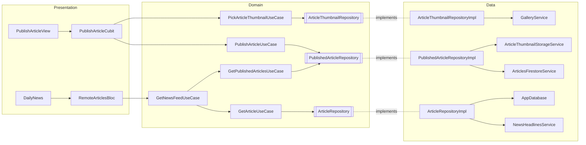
The publishing flow uploads the thumbnail first and then creates the article that references it, so an article never points to a missing image. The schema is documented in [backend/docs/DB_SCHEMA.md](../backend/docs/DB_SCHEMA.md).

### 7.3 Justified exceptions to the coding guidelines
- **CG3.5 (few arguments).** Entity, model and state constructors (and the `OutlinedTextArea` widget) take more than three *named* parameters. They are value objects mirroring the schema fields, like the original `ArticleEntity` with eight.
- **Screens obtain their cubit from the service locator (`sl`)**, as the starter's screens already did.
- **Firebase is initialized in the dependency container**, the composition root that already builds the other providers (Dio, the local database). No layer imports a provider outside data sources.

### 7.4 Security
| Layer | Measure |
|---|---|
| Firestore rules | Only documents that match the schema can be created; nothing can be updated or deleted; every other collection is denied. |
| Cloud Storage rules | Only images (jpeg, png, webp, max 5 MB) in `media/articles`; no overwrite, update or delete; every other path is denied. |
| Rules tests | 30 tests on the Local Emulator Suite; one of them found the overwrite hole before deploying. |
| Firebase API key | Public by design (it identifies the project, it grants no access) and restricted in Google Cloud to the app's package name and signing certificate. |
| Cost protection | Blaze plan with the bucket in a no-cost region and a budget alert. |
| **Known risk: news API key** | Hard-coded in the starter. It cannot be hidden inside a mobile app (it can be extracted from the APK) and it is already public in the original repository. The correct solution is a Cloud Functions proxy that keeps the key as a server-side secret (6.3). |

No secrets (service account keys, admin credentials) are stored in the repository.

### 7.5 Use of AI
I used Claude Code (Anthropic) as a pair programmer, openly: every commit is co-signed. The AI proposed and wrote code. I set the priorities (for example, fidelity to the design over my own preferences, and compliance with every rule), and I reviewed and approved each decision and each pull request, always against the project documentation.
