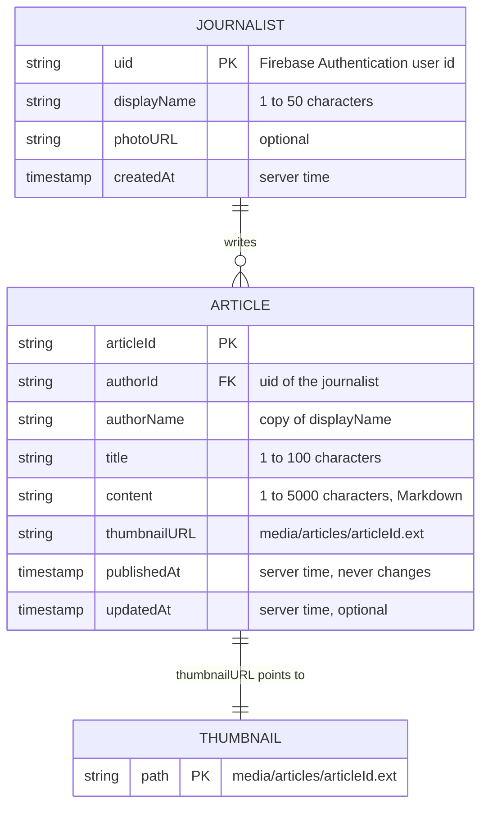
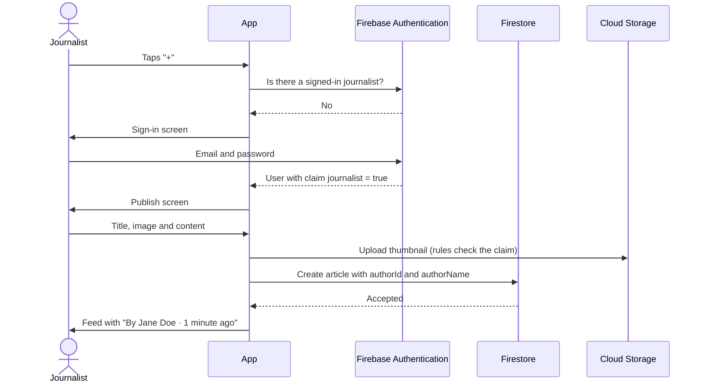

# Prototype 2 – Journalists with an account

**Status: proposal, not implemented.** Nothing in this document is deployed or part of the app. It describes how the next step of the feature could work.

## Why
Today anyone with the app can publish, and nobody can fix a typo or remove an article: the rules deny every update and delete, because there is no way to know who wrote what. Giving journalists an account solves both problems:
- only journalists can publish;
- each article shows who wrote it;
- each journalist can edit and delete their own articles, and nobody else's.

## Data model



Changes from the [current schema](DATA_MODEL.md):
- **New `journalists/{uid}` collection**, one document per account, with the public profile.
- **`articles` gains `authorId`, `authorName` and `updatedAt`.** `authorName` is a copy of the journalist's name, so the feed still needs one query and no extra reads. If a journalist renames themselves, a Cloud Function updates the copies.
- **Who is a journalist** is decided by an administrator, not by the sign-up form: a custom claim `journalist: true` set with the Admin SDK. Readers can still use the app without an account.

## Security rules (sketch)

```
match /articles/{articleId} {
  allow read: if true;
  allow create: if isJournalist()
    && request.resource.data.authorId == request.auth.uid
    && isValidNewArticle(articleId, request.resource.data);
  allow update: if isAuthorOf(resource.data)
    && changesOnly(['title', 'content', 'thumbnailURL', 'updatedAt'])
    && request.resource.data.updatedAt == request.time;
  allow delete: if isAuthorOf(resource.data);
}

match /journalists/{uid} {
  allow read: if true;
  allow write: if request.auth.uid == uid && isJournalist();
}

function isJournalist() {
  return request.auth != null && request.auth.token.journalist == true;
}

function isAuthorOf(article) {
  return isJournalist() && article.authorId == request.auth.uid;
}

function changesOnly(fields) {
  return request.resource.data.diff(resource.data).affectedKeys().hasOnly(fields);
}
```

The Storage rules would follow the same idea: only journalists can upload, and only the author of an article can replace or delete its thumbnail (Storage rules can read the article with `firestore.get()`).

## User journey



## Screens

```
Feed                           Detail of my own article
┌──────────────────────────┐   ┌──────────────────────────┐
│ [img] Title              │   │ <            ✎ Edit  🗑   │
│       Description…       │   │ Title                    │
│       [Journalist]       │   │ [Journalist] Jane Doe    │
│       Jane Doe · 2h ago  │   │ 2 hours ago · edited     │
│                     [+]  │   │ [image]                  │
└──────────────────────────┘   │ Content…                 │
                               └──────────────────────────┘
```

- **Sign-in screen** with the lilac buttons and Inter text of the prototype. It is shown only when a reader taps "+".
- **Edit** reuses the publish screen, filled with the article. **Delete** asks for confirmation.
- **The badge shows the author's name** under it, using the `author` field that `ArticleEntity` already has for the news API articles.

## Clean Architecture

| Layer | New pieces |
|---|---|
| Data | `FirebaseAuthService`, the only file that imports `firebase_auth` (rule 1.2.4); `JournalistModel` with `toEntity`/`fromRawData`; `AuthRepositoryImpl` returning `DataState`. |
| Domain | `JournalistEntity`; `AuthRepository` interface; `SignInUseCase`, `SignOutUseCase`, `GetSignedInJournalistUseCase`, `UpdateArticleUseCase`, `DeleteArticleUseCase`; ownership check `ArticleEntity.isWrittenBy(journalist)` in the entity (rule 2.2.2). |
| Presentation | `AuthCubit` with signed-out, signing-in, signed-in and error states; sign-in screen; edit and delete actions in the detail screen. |

## How it would be tested
- **Rules tests** with `@firebase/rules-unit-testing`, which the project already uses: `authenticatedContext('jane', { journalist: true })` for a journalist, a second journalist who must not edit Jane's articles, and a reader without the claim who must not publish.
- **Unit and widget tests** for the new entities, use cases, cubit and screens, with the same mocks as today.
- **Integration test**: the current publishing journey plus signing in, on the Firebase Authentication emulator.

## Migration
Articles published before this change have no `authorId`. They stay readable, are shown as written by "Symmetry News", and cannot be edited by anyone.
