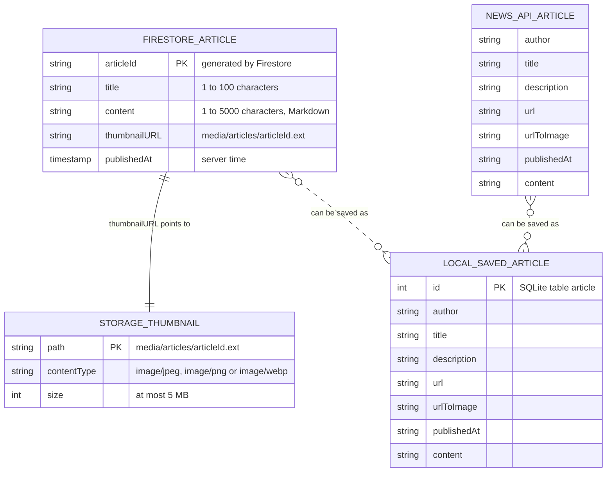
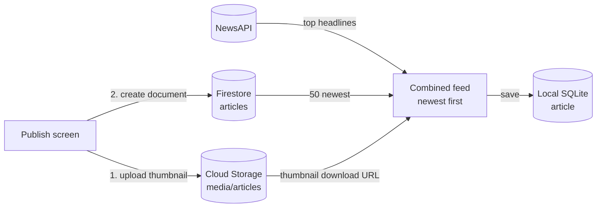

# Prototype 1 – Data model of the app

This diagram shows every place where the app keeps articles and how they relate. The written schema, with its validation rules, is in [backend/docs/DB_SCHEMA.md](../../backend/docs/DB_SCHEMA.md).

GitHub renders the diagrams below. In other viewers, paste them into [mermaid.live](https://mermaid.live).

## Entities and relations

- **Firestore `articles`** holds the articles written by journalists. Each document has exactly four fields; the security rules reject any other shape.
- **Cloud Storage `media/articles`** holds one thumbnail per article. The file and the document share the same `articleId`, so each document points to exactly one file.
- **NewsAPI** articles are not stored by the app: they are read on every feed refresh.
- **Local SQLite table `article`** keeps the articles the reader saves, from either source, so they can be read offline.

## How the feed is built

The thumbnail is uploaded before the document is created, so a document never points to an image that does not exist yet.

## Files of this prototype
- This document: `docs/prototypes/DATA_MODEL.md`.
- The schema it describes: [backend/docs/DB_SCHEMA.md](../../backend/docs/DB_SCHEMA.md), [backend/firestore.rules](../../backend/firestore.rules) and [backend/storage.rules](../../backend/storage.rules).
- The local table: [saved_article_record.dart](../../frontend/lib/features/daily_news/data/data_sources/local/saved_article_record.dart).
